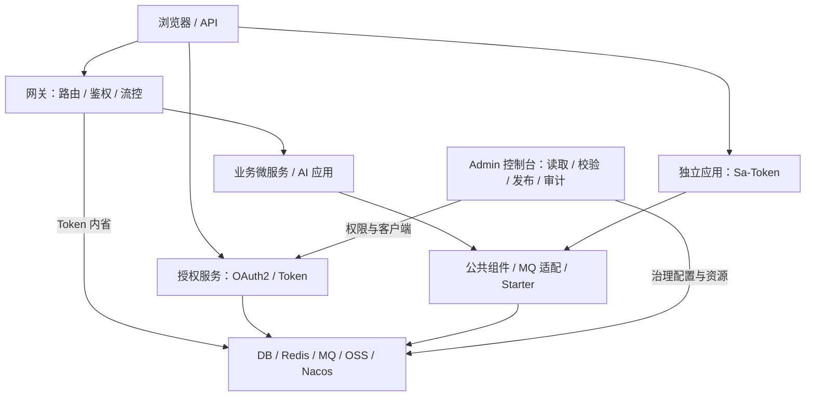

# Fons4Cloud

**为 Java 应用提供可复用的微服务底座与配置治理能力。**

Fons4Cloud 基于 Java 21、Spring Boot 和 Spring Cloud，将 **认证、网关、消息、公共组件与治理控制台** 组织为可组合的模块。业务应用按需引入基础库，微服务通过网关与授权服务接入，治理控制台通过目标适配器管理配置变更和运行信息。

**[系统架构](#架构概览) · [核心设计](#核心设计) · [快速接入](#快速接入) · [应用项目](#应用项目) · [项目地图](docs/wiki/index.md)**

Java 21 · Spring Boot · Spring Cloud · Dubbo · Sa-Token · Vue 3

## 架构概览



网关、授权和治理服务承担运行职责，公共组件与 Starter 由应用按需引用。完整分层、接入方式和职责边界见 [系统架构](docs/architecture.md)。

## 核心设计

| 工程问题 | 设计方式 | 深入阅读 |
| --- | --- | --- |
| 微服务与独立应用如何选择认证方式？ | 微服务采用 OAuth2 授权、网关资源鉴权与用户透传；独立应用可选择 Sa-Token 会话认证 | [认证路径与请求时序](docs/gateway-auth.md) |
| 如何减少 MQ 接入的重复代码？ | Stream 协议统一消息、发送与结果；Kafka、RabbitMQ、RocketMQ 适配保留各自差异，本地消息持久化通过扩展口接入 | [消息抽象与发送时序](docs/messaging.md) |
| 如何判断一次配置发布真正完成？ | 草稿校验后比较目标基线，发布后回读确认；区分漂移、明确失败与待确认，并记录快照和执行过程 | [治理发布时序](docs/governance.md#治理发布流程) |
| 如何组合基础能力？ | 数据库、缓存、锁、限流、文件、调度等拆为独立模块，通过自动配置和扩展点接入应用 | [模块分层与接入方式](docs/architecture.md) |

> [!NOTE]
> 集中授权与 Sa-Token 独立认证是不同接入路径。应用按场景组合基础组件，无需部署架构图中的全部服务与中间件。

## 模块导航

| 目录 | 内容 |
| --- | --- |
| [fons4cloud-auth](fons4cloud-auth/) | 认证公共模型、Spring Security 接入、OAuth2 授权服务、Sa-Token 独立认证 |
| [fons4cloud-gateway](fons4cloud-gateway/) | Spring Cloud Gateway、Nacos 动态路由、鉴权、用户透传、节流与 Sentinel 集成 |
| [fons4cloud-mq](fons4cloud-mq/) | 消息 API、公共协议、Kafka / RabbitMQ / RocketMQ 适配 |
| [fons4cloud-common](fons4cloud-common/) | 基础模型、工具、Web、DB、缓存、锁、限流、文件、调度等公共组件 |
| [fons4cloud-starter](fons4cloud-starter/) | Nacos 与 Dubbo Starter |
| [fons4cloud-admin](fons4cloud-admin/) | 治理 API、应用服务与 Vue 控制台 |
| [fons4cloud-infrastructure](fons4cloud-infrastructure/) | 基础服务 API 与短信策略等实现；当前包含 Mock 短信策略 |

## 快速接入

### 1. 安装框架依赖

准备 **JDK 21、Maven**。完整构建还包含控制台前端，需要其 [package.json](fons4cloud-admin/fons4cloud-admin-ui/package.json) 声明的 **Node 24.11.1 / npm 11.6.2**。在仓库根目录执行：

```bash
# 初始化前端依赖与 lock 文件
npm --prefix fons4cloud-admin/fons4cloud-admin-ui install
# 安装框架模块到本地 Maven 仓库
mvn install -DskipTests
```

前端 [POM](fons4cloud-admin/fons4cloud-admin-ui/pom.xml) 在构建时执行 `npm ci`；当前未跟踪 lock 文件，首次检出需先用 `npm install` 生成它。上述构建跳过测试，运行服务还需准备对应配置、数据库与中间件，见 [本地运行准备](docs/governance.md#本地运行准备)。

### 2. 按需引入模块

例如，独立 Spring Boot WebMVC 应用可引入 Sa-Token 认证模块：

```xml
<dependency>
    <groupId>com.fons.cloud</groupId>
    <artifactId>fons4cloud-auth-satoken</artifactId>
    <version>1.0.0</version>
</dependency>
```

该模块封装登录、会话查询与令牌管理，会话持久化复用 Redis。应用仍需实现登录业务、权限角色与拦截配置，详见 [独立认证接入](docs/gateway-auth.md#独立认证接入)。

## 应用项目

| 项目 | 与框架的关系 | 阅读入口 |
| --- | --- | --- |
| 框架治理控制台 | 本仓库的 Vue 前端与治理服务，包含服务、网关、流量、权限、客户端、变更与审计工作区 | [架构与发布设计](docs/governance.md) |
| [Fons4AI](https://github.com/nauyiq/fons4ai) | 复用部分公共组件，构建 Agent、响应式运行管理和文档处理能力 | [AI 框架仓库](https://github.com/nauyiq/fons4ai) |
| [Trip 智能差旅助手](https://github.com/nauyiq/fons4ai-trip) | Java AI 应用接入实例，组合独立认证与差旅 Agent 业务 | [应用源码](https://github.com/nauyiq/fons4ai-trip) |
| [Rag2OKF 知识库应用](https://github.com/nauyiq/fons4ai-rag2okf) | 知识库、文档解析与分块管理应用 | [应用源码](https://github.com/nauyiq/fons4ai-rag2okf) |

## 设计文档

| 文档 | 内容 |
| --- | --- |
| [系统架构](docs/architecture.md) | 模块分层、库与运行服务、应用接入方式 |
| [网关与认证](docs/gateway-auth.md) | Token 内省、用户透传、动态路由与独立认证边界 |
| [消息设计](docs/messaging.md) | Stream 抽象、多 MQ 差异、本地事务消息时序 |
| [治理控制台设计](docs/governance.md) | 控制台职责、治理发布时序、源码入口与运行准备 |

<details>
<summary>依赖版本与实现范围</summary>

版本以 [根 POM](pom.xml) 为准：Spring Boot 3.5.8、Spring Cloud 2025.0.0、Spring Cloud Alibaba 2025.0.0.0、Dubbo 3.3.0、Sa-Token 1.45.0。控制台使用 Vue 3、TypeScript、Vite 与 Ant Design Vue。

文档依据 2026-10-16 的 `master` 源码整理，代码基线为 `6dd01d9`，描述模块实现与应用关系。具体部署、故障恢复和性能表现应结合相应场景验证。

</details>
