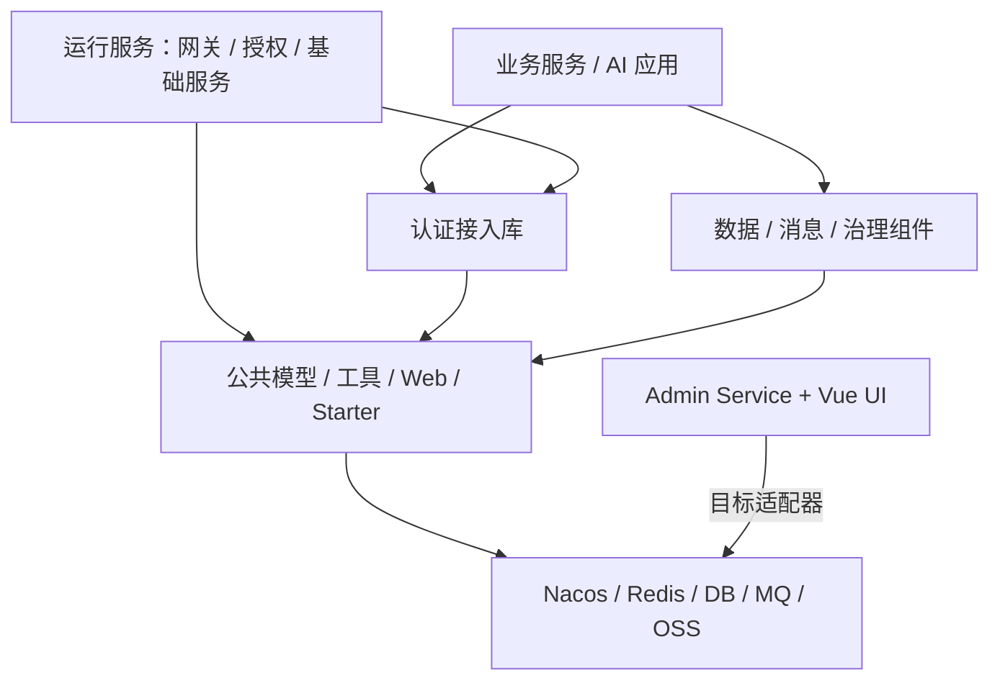

# Fons4Cloud 系统架构

[返回 README](../README.md) · [网关与认证](gateway-auth.md) · [消息设计](messaging.md)

## 库、服务与控制面

Fons4Cloud 同时包含可嵌入应用的基础库和可独立运行的服务。公共模块降低应用接入成本；网关、授权服务与管理服务承担运行职责。不能把 Maven 模块数量当成需要部署的微服务数量。

图表达职责与按需集成，不承诺列出的中间件都在某个演示环境同时运行。SkyWalking 模块也不等于已经安装 Java Agent 并部署完整后端。

## 接入方式

| 应用形态 | 可选路径 | 应用需要补充的内容 |
| --- | --- | --- |
| 统一入口的微服务 | Gateway + Auth Service + 资源侧认证接入 | 客户端、资源权限、白名单、路由、信任边界 |
| 独立 Web 应用 | `fons4cloud-auth-satoken` + 按需公共模块 | 登录业务、权限角色实现、Redis 与拦截配置 |
| 消息驱动应用 | `common-stream` + 选定 MQ 适配 | Topic / Queue、消费逻辑、幂等、重试与补偿策略 |
| 治理控制台 | Admin UI + Admin Service + 目标适配器 | 管理员权限、目标服务连接、治理表与初始化数据 |

独立认证不需要为登录而强制部署集中授权服务。反过来，Sa-Token 会话也不能直接当作网关 OAuth2 Token 使用。

## 控制面如何连接运行服务

Admin 用 `GovernanceTargetAdapter` 隔离不同治理目标。网关路由通过 Nacos 适配器处理，OAuth 客户端和访问资源通过授权能力处理。应用服务组织草稿、校验、发布、快照和审计，目标适配器处理实际的读取、校验和写入。

治理发布先比较当前配置摘要与草稿基线；写入之后回读确认。数据库中记录发布状态，并不自动代表目标系统已经更新成功。详细时序见 [治理控制台设计](governance.md#治理发布流程)。

## 设计取舍

公共接口屏蔽调用方式上的重复，适配模块保留技术差异。例如统一消息发送入口不能消除 Kafka 分区、RabbitMQ 交换机和 RocketMQ 事务半消息的差别；认证公共模型也不消除集中授权与独立会话的区别。

框架提供扩展点与已有实现。服务部署、资源归属、故障恢复和性能表现需要结合应用验证，不能从组件封装直接推导出生产级 SLA。

## 源码导航

| 主题 | 入口 |
| --- | --- |
| 统一依赖版本与聚合模块 | [pom.xml](../pom.xml) |
| 自动配置与公共组件 | [fons4cloud-common](../fons4cloud-common/) |
| 认证模块 | [fons4cloud-auth](../fons4cloud-auth/) |
| 网关运行服务 | [GatewayMain](../fons4cloud-gateway/src/main/java/com/fons/cloud/gateway/GatewayMain.java) |
| 治理编排 | [GovernancePublishService](../fons4cloud-admin/fons4cloud-admin-service/src/main/java/com/fons/cloud/admin/application/GovernancePublishService.java) |
| 治理目标接口 | [GovernanceTargetAdapter](../fons4cloud-admin/fons4cloud-admin-service/src/main/java/com/fons/cloud/admin/domain/adapter/GovernanceTargetAdapter.java) |
