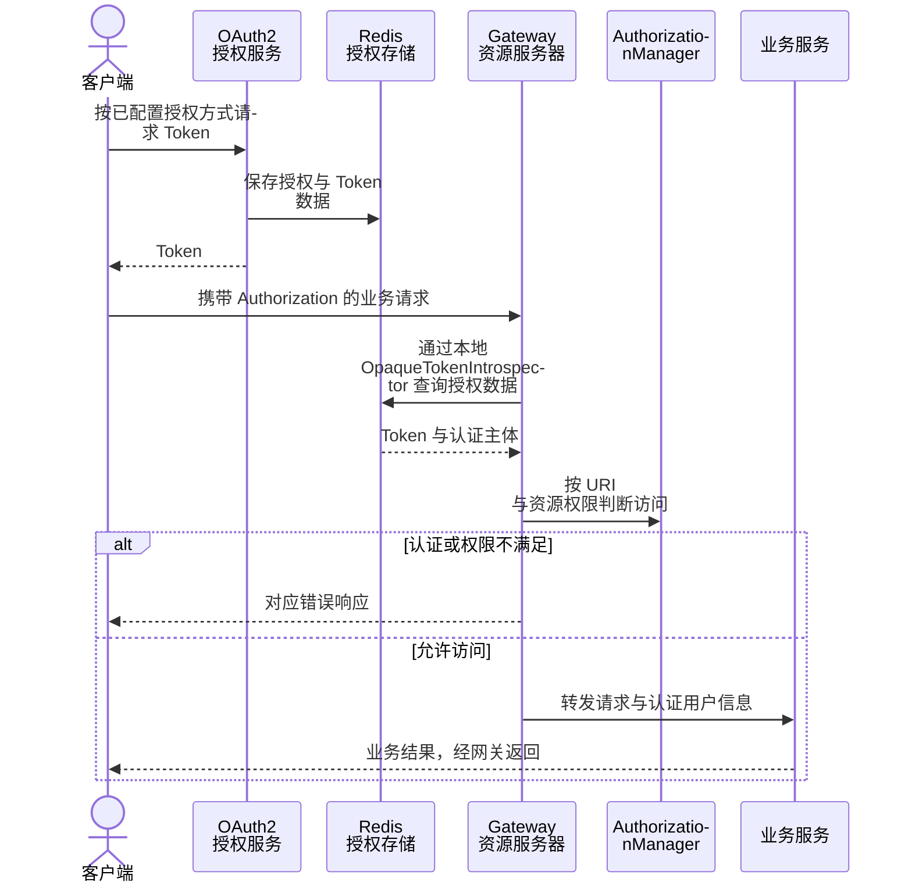
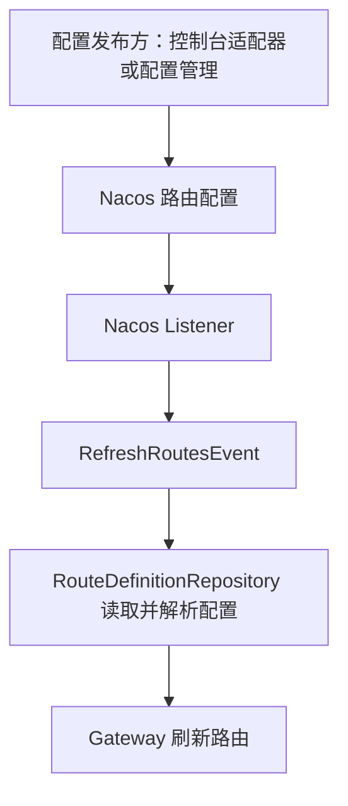

# 网关、认证与动态路由

[返回 README](../README.md) · [系统架构](architecture.md)

## 两条认证路径

| 路径 | 实现位置 | 适用场景 |
| --- | --- | --- |
| 集中授权与资源鉴权 | `auth-service`、`auth-spring-security`、`gateway` | 统一授权服务与网关接入的微服务应用 |
| 独立会话认证 | `auth-satoken` | 不要求接入集中授权服务的独立 Web 应用 |

两条路径共享项目中的部分模型与组件，但 Token 和权限来源需要分别配置。

## 集中认证请求链

图描述需要鉴权的普通 Bearer Token 请求，白名单和其他认证分支以安全配置为准。当前网关在 `ResourceServerConfiguration` 中使用 `RedisOAuth2AuthorizationService` 与 `DefaultReactiveOpaqueTokenIntrospector`，并非每次请求都远程 HTTP 调用授权服务。

`SecurityAuthenticationFilter` 在认证上下文中提取用户，写入后续请求使用的用户头；在其处理的有效 Authorization 分支中，会拒绝客户端预先携带同名用户头。这个检查不等于完整的网络信任边界，应用仍需按部署限制绕过网关直接访问的路径。

## 动态路由链

`NacosRouteDefinitionRepository` 监听配置变化并发布刷新事件，读取时将配置解析为 `RouteDefinition`。其 `save` / `delete` 当前没有写入实现，因此不能把这个 Repository 当作已经实现的路由 CRUD 接口；治理写入走独立的目标适配器。

## 独立认证接入

`FonsSaTokenAutoConfiguration` 装配 `SaTokenAuthTemplate`、默认 `StpInterface` 和 Web 拦截配置。原生 Sa-Token Starter 提供会话能力，Redis Jackson 集成承接会话持久化。

默认权限和角色实现为空，业务应用需要提供实际 `StpInterface`，并确认拦截范围与白名单。仅引入依赖不代表登录业务、角色权限和全部路由保护已完成。

## 源码入口

| 主题 | 入口 |
| --- | --- |
| 网关资源鉴权与内省 | [ResourceServerConfiguration](../fons4cloud-gateway/src/main/java/com/fons/cloud/gateway/config/ResourceServerConfiguration.java) |
| 请求权限判定 | [AuthorizationManager](../fons4cloud-gateway/src/main/java/com/fons/cloud/gateway/server/auth/AuthorizationManager.java) |
| 认证用户透传 | [SecurityAuthenticationFilter](../fons4cloud-gateway/src/main/java/com/fons/cloud/gateway/filter/SecurityAuthenticationFilter.java) |
| Nacos 路由读取与监听 | [NacosRouteDefinitionRepository](../fons4cloud-gateway/src/main/java/com/fons/cloud/gateway/nacos/NacosRouteDefinitionRepository.java) |
| 独立认证自动配置 | [FonsSaTokenAutoConfiguration](../fons4cloud-auth/fons4cloud-auth-satoken/src/main/java/com/fons/cloud/auth/satoken/autoconfigure/FonsSaTokenAutoConfiguration.java) |

## 如何复查

在隔离演示环境中分别检查有效 Token、失效 Token、无资源权限和白名单请求，再检查一次路由配置刷新。独立认证应另外检查登录、登出、角色权限与 Redis 会话状态。仓库中的网关和认证测试可辅助核对分支，完整链路仍依赖实际服务与资源配置；本次未执行这些运行验证。
