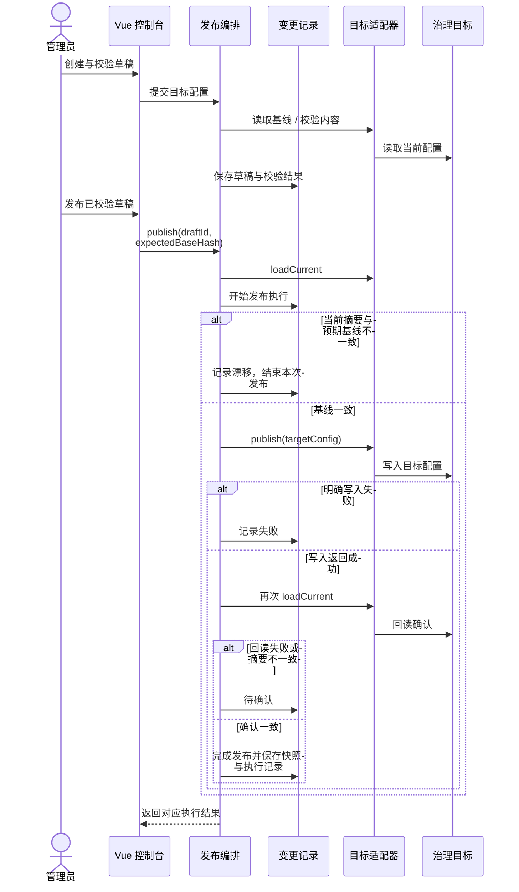

# 治理控制台与发布设计

[返回 README](../README.md) · [系统架构](architecture.md) · [网关与认证](gateway-auth.md)

## 控制台与应用入口

| 入口 | 可以了解什么 | 状态说明 |
| --- | --- | --- |
| [Admin 前端](../fons4cloud-admin/fons4cloud-admin-ui/) | 服务、网关、流量、访问资源、客户端、变更与审计工作区 | 有 Vue 页面和对应后端实现，未在本次重新启动 |
| [Admin 后端](../fons4cloud-admin/fons4cloud-admin-service/) | 运行信息读取、治理适配、变更发布与审计 | 需要目标系统与初始化数据 |
| [Trip](https://github.com/nauyiq/fons4ai-trip) | Fons4Cloud 基础组件与 AI 应用组合 | 应用源码入口 |
| [Rag2OKF](https://github.com/nauyiq/fons4ai-rag2okf) | 知识库与文档处理应用 | 应用源码入口 |

## 控制台使用流程

1. 登录后查看服务与配置概况，解释控制台读取的目标和权限范围。
2. 在隔离演示环境中选择一项网关路由配置，创建草稿并查看差异。
3. 执行校验，说明校验结果与当前目标基线的关系。
4. 发布后展示目标回读、快照与审计记录；再用已准备的场景说明漂移或待确认状态。

这条流程解释控制台的设计意图；实际操作需要具备目标资源与权限，并非本次已执行的操作。

## 治理发布流程



设计关注的是远程写入与本地状态之间的差异：目标写入成功后也可能读不到确认结果，因此不能直接显示“已发布成功”。回滚同样经过治理编排，不能理解成不受条件限制的数据库撤销。

源码入口：[GovernancePublishService](../fons4cloud-admin/fons4cloud-admin-service/src/main/java/com/fons/cloud/admin/application/GovernancePublishService.java)、[ChangeApplicationService](../fons4cloud-admin/fons4cloud-admin-service/src/main/java/com/fons/cloud/admin/application/ChangeApplicationService.java)、[治理适配接口](../fons4cloud-admin/fons4cloud-admin-service/src/main/java/com/fons/cloud/admin/domain/adapter/GovernanceTargetAdapter.java)。

## 本地运行准备

本仓库没有统一的一键部署脚本。根据需要运行的服务准备条件：

| 内容 | 需要确认的条件 |
| --- | --- |
| 构建 | JDK 21、Maven；前端按 `package.json` 声明使用 Node 24.11.1 / npm 11.6.2 |
| 配置与注册发现 | Nacos 地址、命名空间、配置项和路由数据 |
| 认证与会话 | 数据库初始化、Redis、客户端 / 管理员 / 权限资源 |
| Admin 目标 | Nacos、授权、服务发现等目标连接与访问权限；治理表与初始化数据 |
| 可选组件 | 按场景准备 MQ、文件存储、调度或观测平台，不要求全部启动 |

配置文件是启动入口参考，不能把个人环境中的地址、账号和密钥直接作为公开演示配置。此处不复制这些值。

### 控制台前端

在 `fons4cloud-admin/fons4cloud-admin-ui` 目录执行：

```bash
npm install
npm run dev
```

[Vite 配置](../fons4cloud-admin/fons4cloud-admin-ui/vite.config.ts) 的开发端口为 `5173`，页面基础路径为 `/admin-ui/`，`/admin/api` 默认代理到本机 `8002` 端口。后端需要另外启动并准备目标系统；若后端端口不同，需要相应调整开发代理。

服务端 [AdminPageController](../fons4cloud-admin/fons4cloud-admin-service/src/main/java/com/fons/cloud/admin/interfaces/page/AdminPageController.java) 提供 `/admin-ui` 和已知工作区路由的 SPA fallback。是否已有可用生产静态资源，要结合实际前端构建和打包结果确认。

### 现有验证入口

前端提供 `npm run typecheck`、`npm run test:unit`、`npm run test:e2e`、`npm run build`。后端包含 [治理发布与应用服务测试](../fons4cloud-admin/fons4cloud-admin-service/src/test/java/com/fons/cloud/admin/application/)，可用于复查漂移、失败和回读确认分支。运行测试仍需要满足各自配置，本文未将这些命令列为本次已通过的检查。

## 如何连接到 AI 应用

从 [Fons4AI](https://github.com/nauyiq/fons4ai) 查看 Agent 运行与文档处理，再进入 Trip 或 Rag2OKF 查看业务入口。Fons4Cloud 解释基础能力与运行治理，AI 框架解释模型与 Agent 工程，应用解释业务目标和实际使用结果。
