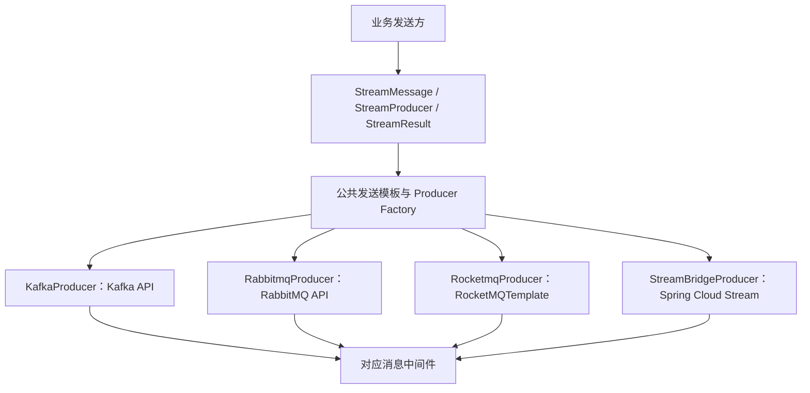
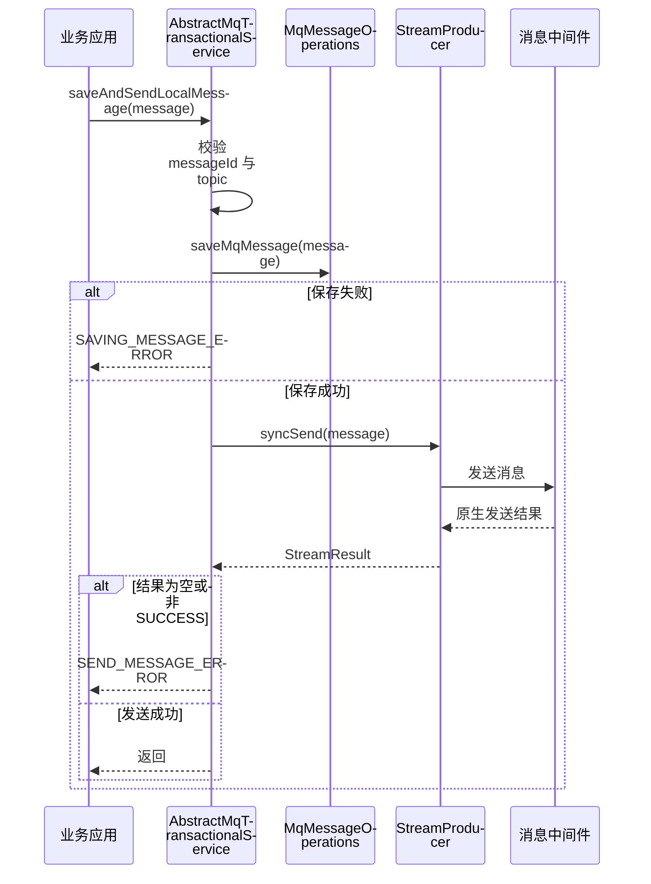

# 消息抽象与多 MQ 适配

[返回 README](../README.md) · [系统架构](architecture.md)

## 抽象什么，保留什么

`common-stream` 提供消息、Producer、回调与结果协议。`fons4cloud-mq` 中各中间件实现将协议映射到原生 API，并保留特有的消息属性和配置。

公共发送接口包含同步、单向与异步发送。具体支持方式和结果语义取决于适配实现，不能将统一接口理解为所有 MQ 的语义完全相同。

## 本地事务消息路径

`AbstractMqTransactionalService.saveAndSendLocalMessage` 的当前实现顺序如下：

这是“先保存、再发送”的扩展骨架。`MqMessageOperations` 由接入方实现；该方法本身不定义业务数据库事务边界，也没有在这里实现自动重试、提交后投递、消费去重或补偿扫描。应用需要明确这些职责后才能声称可靠消息闭环。

发送失败是否留下可补偿记录还取决于调用方事务是否回滚，不能仅凭“已调用保存”推断消息最终已落库。

## 中间件差异

| 适配 | 可定位的实现 | 阅读重点 |
| --- | --- | --- |
| Kafka | Producer、Factory、Topic 初始化、Canal Listener | 分区、Topic 与原生发送结果 |
| RabbitMQ | Producer、Factory、交换机 / 队列初始化、本地事务消息适配 | Exchange / Queue / Routing 与确认策略 |
| RocketMQ | `RocketmqProducer` 与 `StreamBridgeProducer` 两条路径 | Destination、顺序消息属性、事务半消息与框架绑定 |

RocketMQ Producer 中存在 `sendMessageInTransaction` 分支，但本地事务判断仍要求接入方提供对应监听与业务逻辑。它与上面的本地消息持久化骨架是不同机制。

## 源码入口

| 内容 | 入口 |
| --- | --- |
| 公共发送接口 | [StreamProducer](../fons4cloud-common/fons4cloud-common-stream/src/main/java/com/fons/cloud/stream/api/StreamProducer.java) |
| 本地事务消息编排 | [AbstractMqTransactionalService](../fons4cloud-mq/fons4cloud-mq-api/src/main/java/com/fons/cloud/mq/api/transactional/service/AbstractMqTransactionalService.java) |
| 消息持久化扩展口 | [MqMessageOperations](../fons4cloud-mq/fons4cloud-mq-api/src/main/java/com/fons/cloud/mq/api/transactional/service/MqMessageOperations.java) |
| Kafka 发送实现 | [KafkaProducer](../fons4cloud-mq/fons4cloud-mq-kafka/src/main/java/com/fons/cloud/mq/kafka/server/KafkaProducer.java) |
| RabbitMQ 发送实现 | [RabbitmqProducer](../fons4cloud-mq/fons4cloud-mq-rabbitmq/src/main/java/com/fons/cloud/mq/rabbit/server/RabbitmqProducer.java) |
| RocketMQ 发送实现 | [RocketmqProducer](../fons4cloud-mq/fons4cloud-mq-rocketmq/src/main/java/com/fons/cloud/mq/rocket/server/RocketmqProducer.java) |

## 演示与验证边界

演示时选择一种中间件，分别展示正常发送、发送失败和重复消费的业务处理，再检查本地消息与事务结果。跨中间件对比应使用相同业务场景，并保留各适配的差异配置。

本次文档没有运行真实 Broker、补偿任务或重复投递验证，因此不提供吞吐、送达率、Exactly Once 或生产高可用结论。
